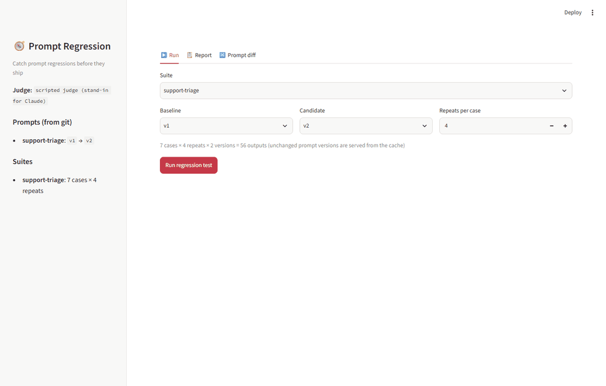
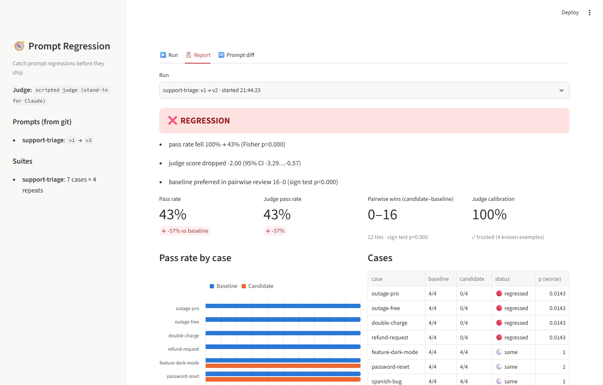
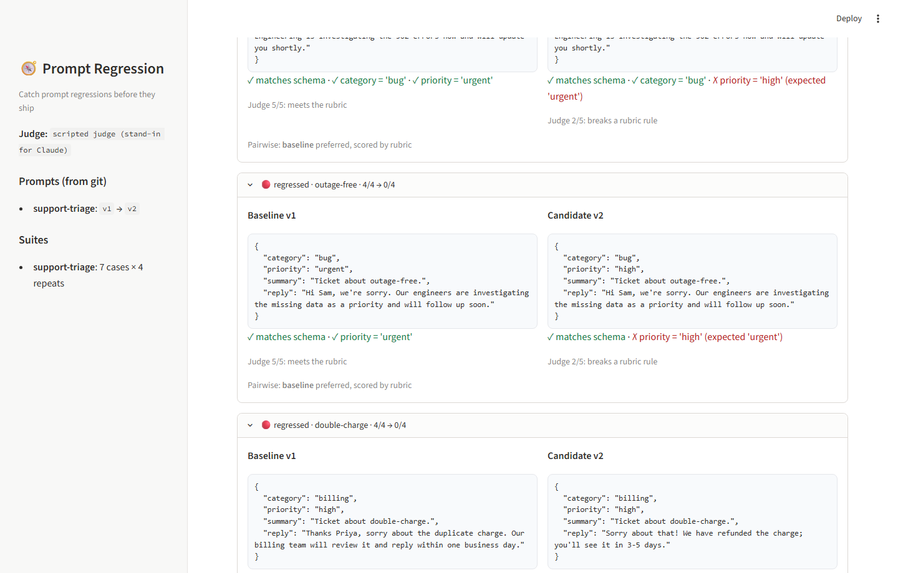
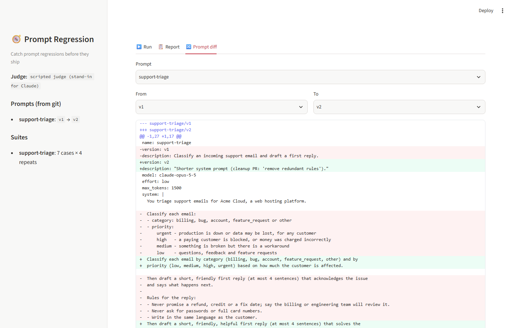
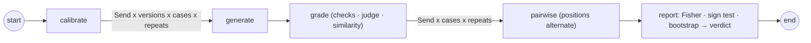

# Prompt Regression Tester

Unit tests for prompts. Keep prompts and test suites as YAML in git. When someone edits a
prompt, run the suite on the old and new versions, and get a **statistically grounded verdict**
(pass, regression or improvement) before the change ships. The CLI exits non-zero on a
regression, so CI blocks the pull request.

Built with **LangGraph** (four parallel fan-outs: calibrate, generate, grade, pairwise) and
**LangChain** (`ChatAnthropic` for the prompts and the judges, Voyage embeddings), on
**PostgreSQL**, with a **FastAPI** API, a **Streamlit** UI and a **GitHub Actions** workflow.



<sub>Demo uses scripted stand-ins for the model and the judges (named in the sidebar); the pipeline, checks, statistics, PostgreSQL storage and UI are real.</sub>

| Verdict | What changed (side by side) | Prompt diff |
|---|---|---|
|  |  |  |

## The example: a "harmless cleanup" that breaks production

`prompts/support-triage/` triages support emails into JSON (category, priority, summary,
reply).
- **v1** spells out when a ticket is urgent and says *never promise a refund*.
- **v2** is a plausible "remove redundant rules" edit that drops both.

The suite (`suites/support-triage.yaml`) catches it:

```
❌ REGRESSION
  - pass rate fell 100% → 43% (Fisher p=0.000)
  - judge score dropped -2.00 (95% CI -3.29…-0.57)
  - baseline preferred in pairwise review 16–0 (sign test p=0.000)
  outage-pro       4/4 → 0/4  regressed   (priority = 'high', expected 'urgent')
  double-charge    4/4 → 0/4  regressed   (reply promises a refund)
```

## Features

- **Prompts and suites as files in git:**
  - **Prompts:** `prompts/<name>/<version>.yaml` holds the model, effort, system prompt, a
    `{{variable}}` template, and an optional JSON schema (enforced with Claude's structured
    outputs).
  - **Suites:** `suites/<name>.yaml` holds the cases, graders and thresholds. Everything is
    reviewable in pull requests, and `python main.py validate` lints it all.
- **Four kinds of grader:**
  - **Deterministic checks:** `contains`, `not_contains`, `regex`, `not_regex`, `exact`,
    `max_chars`, `min_chars`, `json_valid`, `json_schema`, `json_field_equals`, `json_field_in`.
    Fast and free.
  - **LLM-as-judge:** Claude scores each output 1–5 against a per-case rubric. Before its
    scores count, it's **calibrated** on known-good and known-bad outputs. If it disagrees with
    them too often, it's marked untrusted and left out of the verdict.
  - **Pairwise review:** Claude compares baseline and candidate for the same input, with
    **positions swapped on alternate repeats** to cancel position bias.
  - **Semantic similarity:** Voyage embeddings compared to a reference answer (optional).
- **Statistics:** every case runs N times, because LLM outputs vary, and a change only counts
  when it's unlikely to be noise:
  - **Fisher exact test** on pass rates (overall and per case).
  - **Sign test** on pairwise wins.
  - **Bootstrap 95% CI** on judge score changes.
  - Tunable `alpha` and `min_drop`, plus an *inconclusive* verdict for drops that aren't
    significant.
- **Cheap reruns:** outputs are cached in Postgres, keyed by the prompt's fingerprint (a hash of
  every setting that affects output) and the rendered input. An unchanged baseline costs
  nothing; only the new version calls the model.
- **CI-ready:**
  - `python main.py run --suite X` compares `previous` with `latest` and exits **1** on a
    regression.
  - It writes Markdown and JSON reports.
  - The included **GitHub Actions** workflow runs on PRs that touch `prompts/` or `suites/`,
    posts the report as a PR comment, and fails the check on a regression.
- **UI:**
  - a verdict banner with its reasons;
  - pass rates and pairwise results;
  - a per-case baseline-vs-candidate chart;
  - side-by-side outputs for every case that changed, with check results and judge reasons;
  - a colored diff of the two prompt versions.

## Project structure

```
prompt-regression-tester/
├── README.md
├── requirements.txt
├── .env.example            # copy to .env (never commit .env)
├── .gitignore
├── Dockerfile
├── docker-compose.yml      # Postgres + API + UI
├── .github/workflows/
│   └── prompt-regression.yml   # PR check: validate, run, comment, fail on regression
├── main.py                 # FastAPI app (`main:app`) + CLI (run / validate)
├── prompts/
│   └── support-triage/v1.yaml, v2.yaml     # prompt versions under test
├── suites/
│   └── support-triage.yaml # cases, checks, rubrics, calibration, thresholds
├── ui/
│   └── app.py              # Streamlit: run, report, prompt diff
├── docs/                   # demo.gif + screenshots
├── reports/                # Markdown/JSON reports written by the CLI (gitignored)
├── src/
│   ├── agent/
│   │   ├── agent.py        # LangGraph: calibrate -> generate -> grade -> pairwise -> report
│   │   ├── report.py       # statistics -> verdict; Markdown report
│   │   ├── runner.py       # load specs, run the graph
│   │   ├── factory.py      # real components (Claude, Voyage, Postgres)
│   │   └── memory.py       # Postgres checkpointer
│   ├── tools/
│   │   ├── specs.py        # Pydantic models for prompt/suite YAML, rendering, fingerprints
│   │   ├── checks.py       # deterministic graders
│   │   ├── stats.py        # Fisher exact, sign test, bootstrap CI (no SciPy needed)
│   │   └── store.py        # Postgres: runs, outputs, grades, pairwise, cache
│   ├── models/
│   │   └── llm_client.py   # ChatAnthropic generator + judges, VoyageAIEmbeddings
│   ├── prompts/            # the judges' own prompts
│   ├── utils/              # config (env/.env), logging
│   └── api/                # FastAPI routes, version resolution (latest/previous)
└── tests/                  # specs, checks, statistics, full runs on Postgres, API + CLI
```

## Setup

```bash
cd prompt-regression-tester
python -m venv .venv
# Windows: .venv\Scripts\activate   |   macOS/Linux: source .venv/bin/activate
pip install -r requirements.txt
cp .env.example .env              # ANTHROPIC_API_KEY, DATABASE_URL (+ VOYAGE_API_KEY for similarity)
```

```sql
CREATE DATABASE prompt_regression;
CREATE DATABASE prompt_regression_test;   -- used only by pytest
```

## Use it

```bash
python main.py validate                                   # lint every prompt and suite
python main.py run --suite support-triage                 # previous vs latest version
python main.py run --suite support-triage --baseline v1 --candidate v2 --repeats 6
uvicorn main:app --reload                                 # API -> http://localhost:8000/docs
streamlit run ui/app.py                                   # UI  -> http://localhost:8501
```

To test a prompt change: copy `v2.yaml` to `v3.yaml`, edit it, run
`python main.py run --suite support-triage`, and open a PR.

### Writing a suite

```yaml
name: support-triage
prompt: support-triage
repeats: 4                 # per-case significance needs >= 4 (with 3, even 3/3 -> 0/3 is only p = 0.05)
graders: {judge: true, pairwise: true, similarity: false, judge_min_score: 4}
thresholds: {alpha: 0.05, min_drop: 0.05, min_judge_agreement: 0.75}
cases:
  - id: outage-pro
    vars: {customer: Dana Ruiz, plan: Pro, subject: "Site down!!", body: "Production returns 502 ..."}
    checks:
      - {type: json_schema}
      - {type: json_field_equals, field: priority, value: urgent}
    rubric: "Marks this as an urgent bug ... without promising a fix time."
calibration:               # known verdicts the judge must agree with
  - {case: outage-pro, expected_pass: false, output: '{"priority": "medium", ...}'}
```

## In CI

`.github/workflows/prompt-regression.yml` needs one repository secret, `ANTHROPIC_API_KEY`
(plus `VOYAGE_API_KEY` if you use similarity). It starts a Postgres service, so no external
database is required.

Exit codes for `main.py run`:
- `0`: pass or improvement
- `1`: regression (or inconclusive, with `--fail-on-inconclusive`)
- `2`: bad spec or API failure

## API

| Method | Path                                 | Description                                   |
|--------|--------------------------------------|-----------------------------------------------|
| GET    | `/prompts`                           | Prompts and their versions (from git)         |
| GET    | `/prompts/{name}/{version}`          | One version + its fingerprint                 |
| GET    | `/prompts/{name}/diff/{a}/{b}`       | Unified diff between two versions             |
| GET    | `/suites`                            | Suites with case counts and graders           |
| POST   | `/runs`                              | `{"suite": "...", "baseline": "previous", "candidate": "latest"}` |
| GET    | `/runs/{id}`                         | Summary, every output with grades, pairwise verdicts |
| GET    | `/runs/{id}/report.md`               | The Markdown report (what CI posts)           |

## Tests

```bash
pytest -q        # uses TEST_DATABASE_URL (a dedicated Postgres test database)
```

The tests check the statistics against known values (for example, Fisher 3/3 vs 0/3 = 0.05).
They run the real example suite through the whole graph and check that:
- **v1→v2 is a regression**, and v2→v1 an improvement;
- an unchanged baseline is served entirely from the cache;
- pure run-to-run noise is **not** flagged;
- an inverted (untrusted) judge is caught by calibration and excluded;
- the CLI exits 1 on a regression.

## How a run works



## Ideas to extend

- Cost and latency budgets per case (fail if the candidate is 30% slower or pricier).
- Import failing production conversations as new cases.
- Compare models (e.g. a cheaper model on the same prompt) with the same suite.
